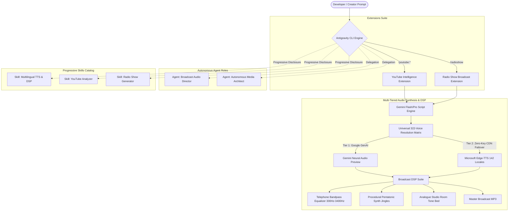

# 🌌 Antigravity CLI Extensions, Agents & Skills

[](https://opensource.org/licenses/MIT)
[](https://www.python.org/)
[](https://github.com/google-gemini)
[](https://github.com/rany2/edge-tts)
[](https://github.com/jiaaro/pydub)

A curated, open-source collection of production-grade **Extensions**, **Autonomous Agent Blueprints**, and **Progressive Skills** designed for **Antigravity CLI** and **Gemini CLI**.

This suite transforms your command-line agent into an autonomous multimedia producer, video intelligence analyst, and talk-radio broadcasting studio with zero API-key dependencies, multi-tiered dynamic model resilience, and studio-grade audio digital signal processing (DSP).

---

## 🏛 System Architecture



---

## 📦 What's Inside the Metapackage?

### 1. 🔌 Extensions

| Extension | Directory | Commands | Description |
| :--- | :--- | :--- | :--- |
| **YouTube Suite** | [`extensions/youtube/`](./extensions/youtube) | `/youtube:search`<br/>`/youtube:transcript`<br/>`/youtube:summary`<br/>`/youtube:translate`<br/>`/youtube:infographic`<br/>`/youtube:podcast`<br/>`/youtube:radioshow` | End-to-end video extraction, summarization, Mermaid infographic generation, 2-host podcasts, and live caller-in radio shows analyzing any YouTube URL. |
| **Radio Show** | [`extensions/radioshow/`](./extensions/radioshow) | `/radioshow` | Standalone autonomous radio broadcast generator for arbitrary text, philosophical essays, or topics with multi-speaker caller debates, procedural jingles, and studio DSP. |

### 2. 🧠 Progressive Skills

| Skill | Directory | Description |
| :--- | :--- | :--- |
| **`multilingual-tts-dsp`** | [`skills/multilingual-tts-dsp/`](./skills/multilingual-tts-dsp) | Dynamic model candidate probing, persistent model caching, 322-voice multilingual mapping, telephone equalization, procedural jingles, and broadcast room tone. |
| **`youtube-analyzer`** | [`skills/youtube-analyzer/`](./skills/youtube-analyzer) | Knowledge extraction, structured summary generation, translation matrix, and multimedia podcast conversion. |
| **`radioshow-generator`** | [`skills/radioshow-generator/`](./skills/radioshow-generator) | 3-act talk radio dialectic structuring, caller persona design, philosophical counterpoints, and sign-off composition. |

### 3. 🤖 Autonomous Agent Blueprints

| Agent Blueprint | Directory | Focus Area |
| :--- | :--- | :--- |
| **Broadcast Director** | [`agents/broadcast-director/`](./agents/broadcast-director) | Specialized subagent for orchestrating complex audio dramas, podcasts, and radio broadcasts with sound design. |
| **Media Architect** | [`agents/media-architect/`](./agents/media-architect) | Specialized subagent for parsing raw media feeds, building Mermaid diagrams, and transmuting video to text/audio. |

---

## ⚡ Quick Start & Installation

### Option 1: One-Click Automated Installer (Recommended)

Clone the repository and run the automated installer:

```bash
git clone https://github.com/AjarnSpencer/antigravity-extensions-agents-skills.git
cd antigravity-extensions-agents-skills
bash install.sh
```

The installer will:
1. Detect and link extensions to `~/.gemini/extensions` and `~/.gemini/antigravity-cli/plugins`.
2. Install global skills to `~/.agents/skills`.
3. Set up isolated Python virtual environments (`venv`) with all required dependencies (`pydub`, `edge-tts`, `google-genai`, `yt-dlp`, etc.).
4. Verify system audio prerequisites (`ffmpeg`).

### Option 2: Selective Installation

To install only a specific extension (e.g., `radioshow`):

```bash
mkdir -p ~/.gemini/extensions/radioshow
cp -r extensions/radioshow/* ~/.gemini/extensions/radioshow/
cd ~/.gemini/extensions/radioshow
python3 -m venv venv
./venv/bin/pip install -r requirements.txt
```

---

## 🎙 Showcase & Usage Examples

### 1. Generate Live Late-Night Radio Broadcasts

```bash
# Generate a live radio show discussing artificial intelligence
/radioshow --topic "Artificial Intelligence Sovereignty and Creative Liberation" --host "Ajarn Spencer" --lang en

# Generate a broadcast in Spanish with full studio sound design
/radioshow --topic "Soberanía Digital y Filosofía de la Inteligencia Artificial" --host "Ajarn Spencer" --lang es --output /tmp/radio_es.mp3

# Generate a broadcast in Thai
/radioshow --topic "สติและการพัฒนาตนเองในยุคปัญญาประดิษฐ์" --host "Ajarn Spencer" --lang th
```

### 2. Dissect & Transform YouTube Videos

```bash
# Search for videos
/youtube:search "Quantum Computing Explained"

# Extract transcript
/youtube:transcript "https://www.youtube.com/watch?v=yXIElG11LgA"

# Generate a detailed summary
/youtube:summary "https://www.youtube.com/watch?v=yXIElG11LgA" detailed

# Generate a Mermaid mindmap / infographic
/youtube:infographic "https://www.youtube.com/watch?v=yXIElG11LgA" --style mindmap

# Convert YouTube video into a 2-host podcast
/youtube:podcast "https://www.youtube.com/watch?v=yXIElG11LgA" --lang en --output /tmp/podcast.mp3

# Convert YouTube video into a live radio caller-in show
/youtube:radioshow "https://www.youtube.com/watch?v=yXIElG11LgA" --host "Ajarn Spencer" --output /tmp/yt_radio.mp3
```

---

## 🎛 Audio DSP & Voice Engineering Highlights

- 📻 **Telephone Bandpass Filtering:** Callers sound authentic via a 300Hz–3400Hz bandpass equalization filter layered with subtle `-48dB` analog line noise.
- 🔔 **Dual-Tone Call Connect Chimes:** Procedural 440Hz + 880Hz sine wave tones announce each incoming caller.
- 🎹 **Procedural Harmonic Jingles:** E-minor pentatonic chords (E3, G3, A3, B3, E4) synthesized with envelope shaping for radio theme intros and outros without requiring external copyright assets.
- 🎙 **Broadcast Studio Ambience:** Continuous `-50dB` warm analogue room tone crossfaded under dialogue to eliminate abrupt digital silence.
- 🌍 **Universal Multi-Language Matrix:** Automatically resolves native neural voices across 75+ languages and 142 locales without requiring user API keys.

---

## 🛡 Security & Community Principles

1. **Zero Hardcoded Secrets:** All tools utilize standard environment variables (`GEMINI_API_KEY`) or Antigravity runtime tokens.
2. **Public-Ready Architecture:** Safe for open-source distribution, forks, and community modifications.
3. **Graceful Zero-Key Fallback:** Audio synthesis operates seamlessly via Microsoft Edge-TTS CDN even without paid API subscriptions.

---

## 🤝 Contributing

Contributions are welcome! Read our [Contributing Guidelines](docs/CONTRIBUTING.md) to add new extensions, skills, or agent blueprints.

---

## 📄 License

Distributed under the [MIT License](LICENSE). Built for the global Antigravity AI and Gemini CLI community.
