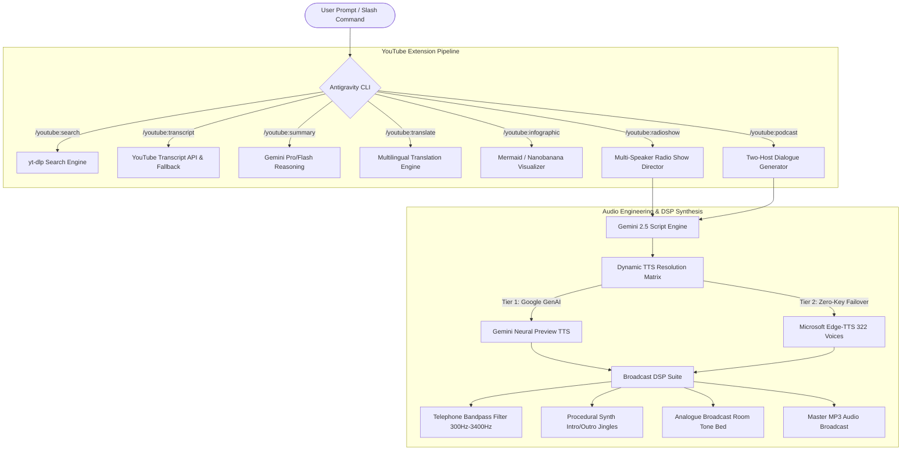

# YouTube Extension for Antigravity CLI & Gemini CLI

A comprehensive, production-ready multimedia intelligence extension for **Antigravity CLI** and **Gemini CLI**. Transform YouTube URLs into deep analytical transcripts, multilingual summaries, Mermaid visual infographics, two-host podcast conversations, and live late-night multi-speaker talk radio broadcasts.

---

## Architecture Overview



---

## Slash Commands Reference

| Command | Syntax | Description |
| :--- | :--- | :--- |
| `/youtube:search` | `/youtube:search <query>` | Search YouTube for top relevant video URLs and metadata. |
| `/youtube:transcript` | `/youtube:transcript <URL>` | Extract clean timestamped transcript from video. |
| `/youtube:summary` | `/youtube:summary <URL> [brief\|standard\|detailed]` | Generate executive summaries and analytical takeaways. |
| `/youtube:translate` | `/youtube:translate <URL> [target_lang]` | Translate transcript into 75+ target languages. |
| `/youtube:infographic` | `/youtube:infographic <URL> [--style mindmap\|flowchart]` | Generate structured Mermaid diagrams and infographic visual prompts. |
| `/youtube:podcast` | `/youtube:podcast <URL> [--lang en\|es\|th] [--output path.mp3]` | Generate a dynamic 2-host conversational deep dive podcast. |
| `/youtube:radioshow` | `/youtube:radioshow <URL> [--host "Name"] [--lang en\|es\|th] [--output path.mp3]` | Generate a full live radio caller-in talk show analyzing the video topic. |

---

## Multi-Speaker Audio & DSP Sound Design

The `/youtube:radioshow` command includes full studio broadcast sound design:
- **Host Persona:** Warm, uncompressed studio broadcast voice with master presence.
- **Caller Personas:** Dynamic caller personas (inquisitive, skeptical, philosophical) with telephone bandpass filters (`300Hz - 3400Hz`) and subtle line noise (`-48dB`).
- **Call Connect Chimes:** Dual-frequency procedural connection tones (`440Hz + 880Hz`).
- **Procedural Intro/Outro Jingles:** Harmonically synthesized E-minor pentatonic chords with exponential amplitude decay.
- **Room Tone Ambience:** Warm analogue broadcast studio room tone (`-50dB`) mixed under all dialogue with smooth crossfading.

---

## Universal Multilingual Voice Matrix

Supports 322 neural voices across 75+ global languages and 142 locales with zero API key dependencies via Microsoft Edge-TTS CDN failover:

- **English (`en`):** `en-GB-RyanNeural` (Host), `en-US-BrianNeural` (Caller 1), `en-US-EmmaNeural` (Caller 2)
- **Spanish (`es`):** `es-ES-AlvaroNeural` (Host), `es-MX-JorgeNeural` (Caller 1), `es-ES-ElviraNeural` (Caller 2)
- **Thai (`th`):** `th-TH-NiwatNeural` (Host), `th-TH-NiwatNeural` (Caller 1), `th-TH-PremwadeeNeural` (Caller 2)
- **French, German, Japanese, Chinese, Arabic, Russian, Portuguese, Hindi, etc.**

---

## Installation & Setup

1. Copy or link this folder to `~/.gemini/extensions/youtube` or `~/.gemini/antigravity-cli/plugins/youtube`.
2. Set up Python environment:
   ```bash
   python3 -m venv venv
   source venv/bin/activate
   pip install -r requirements.txt
   ```
3. Set your Google API key (optional for basic features; audio failover works keyless):
   ```bash
   export GEMINI_API_KEY="your-api-key-here"
   ```

---

## License

MIT License. Open source and free for the Antigravity CLI and Gemini CLI developer communities.
